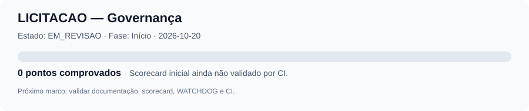

# LICITACAO — Governança e preparação do projeto

| Campo | Valor |
|---|---|
| **ID** | LIC-README-001 |
| **Projeto** | LICITACAO |
| **Repositório** | [carlos-andrade/LICITACAO](https://github.com/carlos-andrade/LICITACAO) |
| **Tipo documental** | README |
| **Fase** | Adoção de governança |
| **Estado** | EM_REVISAO |
| **Versão** | 0.2.0 |
| **SHA-256 (conteúdo canónico)** | 9da9e7d2e7debc1758904b7ecade2aab4b3dd5352387dd10499b3d6bccaa3812 |
| **Commit de referência (versão anterior)** | [f42637de27d382049109e30bb7f05008815d45ef](https://github.com/carlos-andrade/LICITACAO/commit/f42637de27d382049109e30bb7f05008815d45ef) |
| **Data de criação** | 2026-10-20 |
| **Data de atualização** | 2026-10-22 |
| **Responsável** | Proprietário do repositório LICITACAO |
| **Aprovador** | Carlos Andrade — decisão de adoção registada em 2026-10-21 |
| **Origem** | Expansão controlada do README inicial |
| **Autoridade superior** | [Constituição local](CONSTITUICAO.md) e [GOVERNANCA](https://github.com/carlos-andrade/GOVERNANCA) |
| **Cadeia de autoridade** | PROMPTS → CARTAS → LAYOUT ÚNICO → CÓDIGO |

 > **Estado de governança: APROVADO_COM_LIMITACOES.** A distribuição normativa e a adoção documental foram aprovadas com limitações explícitas; isto não certifica conformidade jurídica nem declara o WATCHDOG operacional.

## Propósito

Preparar uma plataforma para identificar, analisar e acompanhar oportunidades de fornecimento de produtos a órgãos públicos brasileiros, com foco em decisões comerciais rastreáveis, custos completos, conformidade com os instrumentos convocatórios e preservação de capital.

## Governança primeiro

O projeto adotou documentalmente a GOVERNANCA com limitações registadas. G0 está aprovado; a próxima fase é G1 — viabilidade. Os controlos WATCHDOG sem evidência permanecem UNKNOWN e não devem ser tratados como operacionais.

- [Constituição local](CONSTITUICAO.md)
- [Carta/Contrato de adoção do roadmap](CARTA-CONTRATO-PADRAO-ROADMAP.md)
- [Roadmap](ROADMAP-PADRAO-GOVERNANCA.md)
- [Registo de status](registry/status-do-projeto.json)
- [Inspeção inicial de adoção](docs/governanca/INSPECAO-DE-ADOCAO.md)
- [Índice de governança](docs/governanca/README.md)
- [WATCHDOG local](WATCHDOG/README.md)
- [Espelho das referências canónicas](.governanca/upstream/UPSTREAM-MANIFEST.json)

## Hierarquia de fontes para licitações

**Fonte oficial primária:** [Portal Nacional de Contratações Públicas (PNCP)](https://pncp.gov.br/). Para identificar e validar editais, avisos, documentos da contratação, retificações, datas, itens, quantidades, valores de referência e situação do procedimento, consultar primeiro o PNCP e os documentos oficiais nele disponibilizados.

- Registrar o link do registo específico e, quando disponíveis, os documentos oficiais originais e suas datas de consulta.
- Usar fontes secundárias apenas como pistas de pesquisa ou apoio; identificá-las expressamente como secundárias e confirmar os dados relevantes no PNCP antes de decidir ou agir.
- Se o PNCP estiver indisponível, incompleto ou não expuser um anexo, registrar a limitação e buscar a plataforma oficial de contratação indicada no instrumento. Não preencher lacunas com suposições nem tratar dados secundários como confirmação oficial.
- Para cada edital, preservar rastreabilidade entre os dados analisados e o registo/documentos oficiais correspondentes.

## Direção comercial preliminar

- **Jurisdição:** Brasil.
- **Modelo:** revenda de produtos adquiridos de distribuidores, atacadistas e fabricantes.
- **Capital de giro de referência:** faixa informada de R$ 50 mil a R$ 200 mil; utilização efetiva dependerá de validação financeira.
- **Categorias:** pesquisa exploratória de múltiplas categorias, com foco definido por evidência de demanda, concorrência, fornecedores, logística e margem.
- **Fontes públicas de referência:** [PNCP](https://pncp.gov.br/app/editais), [Compras.gov.br — fornecedores](https://www.gov.br/compras/pt-br/fornecedor-1/fornecedor) e legislação vigente aplicável.

Nenhuma proposta, preço, fornecedor ou edital será considerado aprovado sem validação específica. Decisões finais de participação, lance, habilitação e execução contratual requerem revisão humana autorizada.

## Status de governança

O registo canónico é `registry/status-do-projeto.json`. O percentual deve ser calculado apenas a partir de critérios e evidências verificáveis segundo a norma de status da GOVERNANCA. O SVG é uma representação provisória; automatizar a sua geração a partir do registo permanece melhoria técnica, não uma alegação de monitorização operacional.

## Limitações atuais

Ainda não há aplicação de negócio implementada. A distribuição upstream foi integrada pela [PR #24](https://github.com/carlos-andrade/LICITACAO/pull/24); a comparação pós-merge confirmou 79/79 Git blob SHA coincidentes e o check `validate` terminou com sucesso ([execução pós-merge](https://github.com/carlos-andrade/LICITACAO/actions/runs/39623794138)). O ruleset `protect-main` está ativo e exige o check `validate`. A checklist WATCHDOG foi executada: 1 controlo PASS e 7 UNKNOWN; por isso, o WATCHDOG não é declarado operacional. A adoção está aprovada com limitações, e os gates de viabilidade/desenho continuam a aplicar-se antes de qualquer implementação funcional. Não guardar credenciais, dados pessoais desnecessários ou informação comercial confidencial no repositório público.

## Próximo marco

Validar esta preparação documental em Pull Request, executar verificações automatizadas e obter revisão/aceitação explícita antes de iniciar a estrutura funcional.
